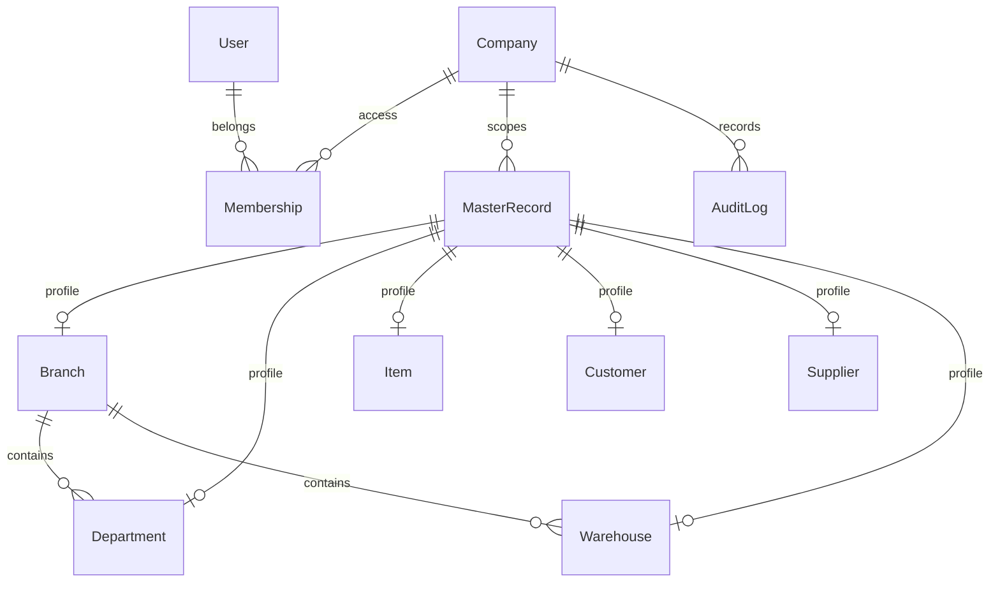

# Enterprise ERP

**Konsistensi modul — 10 November 2026:** header daftar Suppliers/Items, ringkasan Procurement/Sales/Accounting, navigasi Workflow, serta shortcut modul memakai komponen dan gaya yang sama. Data dan aksi tetap mengikuti API serta Company aktif. Pemeriksaan visual browser masih tertahan karena host akses browser tidak tersedia; lihat [catatan implementasi](docs/apple-workspace.md).

**Pembaruan UI desktop — 6 November 2026:** desain Apple-inspired dari FigCraft telah diterapkan pada shell web dan Dashboard: sidebar/toolbar dengan efek kaca, Company Switcher pada header dan sidebar, profil di sidebar, enam KPI dalam satu permukaan, grafik dan tabel solid, serta komponen tombol/menu/dialog yang konsisten. Mode live tetap menggunakan API dan validasi Company/Role yang ada. Mode demo tetap ditandai dan nilai Inventory demo bersifat ilustrasi. Lihat [cakupan implementasi dan verifikasi](docs/apple-workspace.md).

Original ERPNext-inspired portfolio application: **one installation, one PostgreSQL database, multiple companies**. No SaaS tenancy, subscription, or marketplace layer.

Phase 1 and Phase 2 provide the workspace, authentication, and core data management. **Phase 3 includes tested Procurement, Inventory, and Sales workflows:** linked purchase documents through Payment; Stock Transfer/Adjustment; and Quotation → Sales Order → Delivery Note → Sales Invoice → Payment. Phase 4 includes operational Reports, Employees/Leave Approval/Attendance, manual double-entry Accounting, single-level BOMs and full Work Order production. Settings provides scoped User access and password/session administration. Accounting now supports opt-in Company mapping, reviewed opening balances and atomic automatic Journals from operational workflows. Financial statements/close, payroll, advanced Manufacturing and custom Permissions/Approval policies remain pending.

## Stack and architecture

- **Web:** Next.js 16 App Router, React 19, TypeScript, Tailwind CSS 4, shadcn/ui-style source components with Radix primitives, Lucide, TanStack Table, React Hook Form, Zod, Recharts, Sonner.
- **API:** NestJS modular monolith, REST, Prisma 6, PostgreSQL, bcrypt password hashes, signed JWT in an HttpOnly cookie, per-company Role checks, rate limiting, Helmet, same-origin mutation checks.
- **Shared:** business types, Zod schemas, development fixtures.
- **Language:** Bahasa Indonesia actions and feedback; established enterprise nouns remain English. UI dictionary: `apps/web/src/lib/i18n.ts`. Navigation terminology is centralized in `navigation.ts`. Dates/numbers use `id-ID`; currency follows the active company, defaulting to IDR.

```text
apps/
  web/
    src/app/                  App Router layouts, routes, login, errors
    src/components/           Shell, Dashboard, domain forms, Company, modules
    src/components/ui/        Composable shadcn-style primitives
    src/components/design/    Interactive Leads, RFQ and Attendance prototypes
    src/lib/design/           Browser-only schemas, fixtures and Company-scoped storage
    src/lib/                  Localization, navigation, API, formatting
  api/
    src/auth/                 JWT sessions, company and Role guards
    src/companies/            Accessible company profiles
    src/master-data/          Typed catalog profiles, queries, relations, audit
    src/documents/            Read-only development document snapshots
    src/procurement/          Linked purchase documents, Approval, Stock ledger
    src/sales/                Linked Sales documents, Delivery, receivables
    src/reports/              Period-filtered Invoice analysis and consistent export
    src/human-resources/      Employee directory, employment lifecycle, Leave Approval
    src/accounting/           Chart, balanced Journals, reversals and precise ledger reports
                              Company mapping, opening adoption and atomic operational posting
    src/manufacturing/        Immutable BOMs, production posting and material requirements
    src/permissions/          Scoped User grants, fixed Roles, membership lifecycle and audit
    src/prisma/               Database lifecycle
    prisma/                   Schema, initial migration, idempotent demo seed
packages/shared/              Types, validation, fictional fixtures
scripts/                      Dedicated local PostgreSQL and verification
docs/                         Reference observations and verification notes
```

## Quick start: browser-local demo

**Current focus — 3 November 2026:** prioritize system functionality and web desktop. Mobile will be developed separately by the project owner; deployment remains deferred. URLs retain the original root paths (`/dashboard`, `/suppliers`, `/api/...`). Attendance and RFQ now use real API/PostgreSQL records in live mode. RFQ compares Supplier quotations, requires independent award Approval and creates linked Purchase Orders. Leads remains an explicit browser prototype. See the [functional roadmap](docs/functional-roadmap.md), [Attendance contract](docs/attendance.md) and [RFQ workflow](docs/rfq.md).

Use Node.js **22.18+** or a newer supported LTS and npm. Installation was verified here with Node 26.12 and npm 11.20 on Windows.

```sh
npm ci --include=dev
npm run dev:design
```

Open **http://localhost:3000/dashboard**. The design command forces root URLs and demo mode for its process, without overwriting existing live environment settings; no database or login is required. Use `npm run dev` instead to follow `apps/web/.env.local`. The three fictional companies are PT Alpha Distribusi, PT Beta Industri, and PT Gamma Digital.

Demo catalog changes and Purchase/Sales Order drafts persist only in this browser's localStorage. Drafts do not post Stock, journal entries, Payments, or Approval events. Gamma demonstrates a read-only Role. Clearing this site's browser storage restores the fixtures.

Existing Phase 1 browser data is upgraded in place. Custom records and demo drafts are retained. Company profiles can be added/edited by a Company Administrator. Deactivating a Company preserves its history and makes its operational data read-only; an Administrator can reactivate it.

The demo Dashboard uses October/September 2026 snapshot periods; demo Stock quantities/value are illustrative. Sales, Procurement, and Inventory processing are available in **live API mode**. The operational Dashboard uses actual Sales/Purchase Invoices, receivables/payables, pending Approvals, and Stock balances, with a six-month Invoice-value chart. Legacy snapshots remain isolated from operational metrics.

## PostgreSQL and live API mode

1. Create a dedicated PostgreSQL development database. With Docker, set `POSTGRES_PASSWORD` in the shell and run `docker compose up -d`. The compose port is localhost-only; change 5432 if already used.
2. Copy `.env.example` to `apps/api/.env`. Set `DATABASE_URL`, a random `JWT_SECRET` of at least 32 characters, and your frontend origin. Do not commit `.env` files.
3. Apply the checked-in migration and seed:

```sh
npm run db:generate
npm exec -w @erp/api -- prisma migrate deploy
npm run db:seed
```

4. Copy `apps/web/.env.example` to `apps/web/.env.local`. Set `NEXT_PUBLIC_DATA_MODE=live`. Restart Next.js whenever changing this build-time flag.
5. Run in two terminals:

```sh
npm run dev:api
```

```sh
npm run dev
```

Open **http://localhost:3000/login**. The web app proxies `/api/*` to NestJS at `127.0.0.1:4010`, so session cookies remain same-origin. NestJS defaults to loopback. For source changes to the API, rebuild with `npm run build -w @erp/api`; the API dev process watches compiled output. Alternatively run `npm exec -w @erp/api -- tsc --watch` in another terminal.

Deployment is deferred. Local routing uses an empty `NEXT_PUBLIC_BASE_PATH`, empty `API_BASE_PATH` and cookie Path `/`. The app keeps Next.js App Router and its `/api/...` proxy. The earlier [subfolder deployment](docs/deployment-subpath.md) and [cPanel/Passenger guide](docs/cpanel-nodejs.md) are historical preparation notes, not the current local setup. Both optional startup files and the hosting install script are retained for a later deployment decision. No public deployment has been performed; the hosting install remained blocked by `Killed`/137.

### Optional Windows local database helper

If PostgreSQL binaries are already installed, `node scripts/local-postgres.mjs` initializes a dedicated `.local/postgres` cluster on **127.0.0.1:55432**, generates local database/JWT secrets, creates the database, and writes `apps/api/.env` only if it does not exist. It never connects to the user's existing PostgreSQL service. Override the binary folder with `POSTGRES_BIN`.

If the Windows sandbox prevents `pg_ctl` from creating a restricted token, run the installed `postgres.exe` directly in a retained terminal with `-D .local/postgres -p 55432 -h 127.0.0.1`, then rerun the helper. This was the verified approach in this environment. Stop only this helper-owned cluster with `node scripts/local-postgres.mjs --stop`, or stop its foreground process.

### Development credentials

The seed refuses to run in production. Its development-only password comes from `DEMO_PASSWORD`; the example is **`DevOnly!ERP2026`**.

With the default local configuration, open **`http://localhost:3000/login`**. The browser origin must exactly match `FRONTEND_ORIGIN`: `http://127.0.0.1:3000` is a different origin and is rejected when the configured origin is `http://localhost:3000`. The login screen distinguishes incorrect credentials, a denied application address, too many attempts, unavailable services and a session that cannot be verified. The README password is an example; existing installations use the password last seeded or changed for that account.

| User                        | Company access                             |
| --------------------------- | ------------------------------------------ |
| `admin@enterprise.local`    | Alpha: ADMIN; Beta: MANAGER; Gamma: VIEWER |
| `viewer@enterprise.local`   | Alpha only: VIEWER                         |
| `reviewer@enterprise.local` | Alpha only: MANAGER; separate HR reviewer  |

Do not expose these demo accounts or use their password in production. The seed uses upserts and preserves existing Company profiles, catalog rows, and domain attributes; rerunning it resets the two base demo account password hashes and Roles to the configured development values and increments their session versions, invalidating prior sessions. Procurement fixtures include posted receipts, an unpaid Invoice, and a pending Request. Sales fixtures use eligible Stock to create an unpaid Alpha Invoice and a paid Beta Invoice through business services. Existing workflow documents are never advanced or overwritten by reseeding. Gamma remains read-only with no posted transaction fixtures.

Open **Settings & Permissions → User & Akses** in Alpha as ADMIN to create a User or grant an existing User access by exact email. New accounts must replace their initial password before using the ERP. Role/status changes affect only the selected Company; history is retained. Beta/Gamma memberships keep their original Roles and are not automatically elevated to ADMIN. See [Permissions](docs/permissions.md) for the password lifecycle, concurrency safeguards, API and limits.

HR fixtures add two Employees each in Alpha/Beta, an Alpha Leave Request pending Approval, and a Beta draft. The HR seed preserves existing Employees, requests, and the reviewer's password/memberships. A different User must review a request, including when the creator is ADMIN; sign in as `reviewer@enterprise.local` to review the seeded Alpha request. See [Human Resources](docs/human-resources.md) for the counting policy and permissions.

Attendance fixtures add up to four records on 2 November 2026 for eligible seeded Employees in Alpha/Beta. Run `npm run db:seed:attendance`, or the full seed. Existing records, Employee profiles, audit history and document sequences are preserved on rerun. The live page at `/attendance` supports real recording, correction reasons/history, monthly filters and all-result export; browser prototype data remains separate. See [Attendance](docs/attendance.md).

RFQ fixtures prepare a dedicated comparison in Alpha awaiting another reviewer's Approval, and an open comparison in Beta. Run `npm run db:seed:rfq`, or the full seed. Existing or partially prepared documents are never advanced/overwritten on rerun, and Company Roles remain unchanged. Open `/requests-for-quotation`; `reviewer@enterprise.local` can review Alpha's award. The seed records fictional offers internally and sends no Supplier messages. See [RFQ](docs/rfq.md).

## Environment variables

Accounting fixtures add an illustrative chart in Alpha/Beta and three posted manual Journals, independent of existing operational documents. Run `npm run db:seed:accounting` after applying migrations, or use the full seed. Repeating this seed preserves existing chart profiles and Journals. See [Accounting](docs/accounting.md) for lifecycle, Role policy, ledger definitions and limits.

Manufacturing fixtures add a three-Item recipe in Alpha/Beta, one completed Alpha Work Order and open material requirements in both Companies. Alpha's materials enter through an authorized Stock Adjustment; Beta intentionally demonstrates a shortage without bypassing its MANAGER Inventory permissions. Run `npm run db:seed:manufacturing`, or the full seed. Existing catalog/recipe/workflow/Stock fields are preserved. See [Manufacturing](docs/manufacturing.md).

Automatic Accounting fixtures prepare five dedicated groups and ten Accounts in Alpha. Run `npm run db:seed:automatic-accounting`, or the full seed, before activation. They do **not** activate a policy or rewrite prior transactions. Open **Accounting → Posting Otomatis**, review the opening snapshot, map the `AUTO-…` Accounts, select the proposed start date and confirm as Alpha ADMIN. Beta/Gamma keep their original Roles. See [Automatic Accounting](docs/automatic-accounting.md) for the boundary, legacy carry-forward, control-account restrictions and current limits.

| Variable                | Location         | Purpose                                                  |
| ----------------------- | ---------------- | -------------------------------------------------------- |
| `NEXT_PUBLIC_DATA_MODE` | web `.env.local` | `demo` (default) or `live`; requires web restart/rebuild |
| `NEXT_PUBLIC_BASE_PATH` | web build/start environment | Empty for the current root routes; changes require rebuild |
| `SESSION_COOKIE_PATH` | API environment | `/` for current session issue/logout/password clearing |
| `API_BASE_PATH` | API environment | Empty; internal API routes keep `/api` |
| `API_URL`               | web `.env.local` | Server-side NestJS proxy destination                     |
| `DATABASE_URL`          | API `.env`       | PostgreSQL connection URL                                |
| `JWT_SECRET`            | API `.env`       | Required random secret, at least 32 characters           |
| `FRONTEND_ORIGIN`       | API `.env`       | Exact origin for CORS and mutation checks                |
| `API_HOST`, `PORT`      | API `.env`       | Default `127.0.0.1:4010`                                 |
| `NODE_ENV`              | API runtime      | Production enables Secure session cookies                |
| `DEMO_PASSWORD`         | API seed only    | Development seed password, at least 12 characters        |
| `POSTGRES_PASSWORD`     | Docker shell     | Compose database password                                |

## Implemented behavior

- Exact primary navigation and logical nested modules; working routes, responsive sidebar/drawer, collapse controls, breadcrumbs, global search (`Ctrl/Cmd + K`), notifications, profile and help dialogs.
- Company switcher updates all displayed catalogs, documents, Dashboard totals, exports, and forms. Local edits remain company-scoped.
- Company creation, profile editing, deactivation/reactivation, search, status filtering, and automatic ADMIN membership for its creator. Company administration requires an ADMIN Role; MANAGER remains able to manage operational catalogs.
- Branch, Department, Items, Customers, Suppliers, Warehouses: domain-specific forms, server-side search/filter/sort/pagination, validation, create/edit/delete, complete filtered CSV export, and loading/empty/error states. Search and list requests cancel obsolete requests and hide previous-company results during switching.
- Branch city/address; Department Branch/Cost Center; Warehouse Branch/address; Items unit/barcode/purchase price/selling price/Stock tracking/reorder threshold; Customer address/Tax ID/credit limit; Supplier address/Tax ID/Payment terms.
- Composite foreign keys enforce same-company Branch relationships. Used Branches cannot be deleted; active dependents prevent deactivation. Non-stock Items cannot have a positive reorder threshold.
- Company codes are immutable. Currency changes are blocked once the Company has document snapshots, Procurement/Sales/Inventory documents, manual Journals, Work Orders, or priced Items. Currency formatting preserves fractional values; no foreign-exchange conversion is performed.
- Live Dashboard: posted Sales/Purchases, receivables/payables, pending Request Approvals, Inventory value, six-month Sales/Purchase Invoice chart, recent documents from both workflows, and actionable Approvals. The chart represents Invoice values, not a General Ledger profit/loss statement. The demo Dashboard retains illustrative Revenue/Expenses snapshots.
- Purchase Order and Sales Order **demo drafts** with validation; document detail dialogs; company-scoped CSV reports.
- Read-only API document snapshots for demonstration, with no posting endpoints.
- Live Procurement: line-item Purchase Requests, submit/approve/reject, sequential source conversion, dated drafts, full posting, draft cancellation, linked-document detail, search/status filters/date sorting/pagination, Payments, and Accounts Payable with settlement status.
- Live RFQ: approved Request selection, immutable requirements and two-to-ten Supplier invitations, complete quotation recording/revision, price/delivery comparison, another-User award Approval, reasoned cancellation without active Orders, versioned/idempotent atomic Order creation, audit, Company isolation and scoped CSV export. The Request's original Supplier/estimate remain intact; RFQ Approval explicitly authorizes the selected Supplier and prices. No Supplier email/portal integration is included.
- Live global search includes actual Procurement, Sales, and Inventory documents; the notifications menu shows pending Purchase Request Approvals and opens their actionable details. Marking notifications read is a local UI interaction, not a background notification service.
- Sales: full-document Quotation → Sales Order → Delivery Note → Sales Invoice → Payment, same-company Customer/Item/Warehouse references, atomic moving-average Stock depletion, serialized posting, version checks, source-chain uniqueness, and audit logging. Customer Credit Limit is checked against posted outstanding Invoices when posting a Sales Invoice; zero means unlimited. Orders/Quotations do not reserve Stock.
- Accounting → Payments switches between incoming Sales and outgoing Procurement Payments. Accounts Receivable and Accounts Payable show posted Invoice settlement status. After Company activation, posted Payments also create balanced cash/bank and party-control Journal entries atomically.
- Manual Accounting: scoped Chart of Accounts, balanced Journal drafts with editing/posting/cancellation, immutable posted API records, ADMIN-only one-time manual Journal reversal, audit, optimistic versions and idempotent numbering. General Ledger includes opening/running balances across pages; Trial Balance covers the full chart. Precise decimal-string reports and all-result CSV exports include inactive history.
- Automatic Accounting: ADMIN-reviewed one-time opening/mapping activation per Company, Receipt/Invoice/Payment/Delivery Journals, Adjustment gains/losses, typed source links and atomic Stock/financial posting. Transfer and full production preserve Company Inventory value and have source records without empty Journals. Generated Journals cannot be manually reversed; mapped control Accounts reject manual Journals. Companies without activation retain the earlier manual-only behavior. See [adoption and limits](docs/automatic-accounting.md).
- Manufacturing: draft/edit/activate/retire single-level BOMs; Work Order snapshots, release/cancel/full completion; atomic material consumption and output receipt through the shared Stock ledger; moving-average material costs with exact value conservation; current material availability and aggregated released requirements by period/Warehouse in Production Plan. Global search and Stock Movement link to real Manufacturing details. Production Plan is a read-only projection, without reservations, capacity scheduling or automatic purchasing.
- Sales/Procurement share reusable form, detail, list, validation, and presentation adapters. Their backend modules and typed database models remain distinct.
- Reports & Analytics: posted Sales/Purchase Invoice registers with inclusive date periods, literal search, settlement as of the period end, consistent filtered metrics/chart/top parties, sorting/pagination, linked details, and all-result CSV export. Each API response uses one Repeatable Read database snapshot; export caps at 10,000 Invoices and never silently truncates. See [report semantics](docs/reports.md).
- Human Resources: company-scoped Employee directory with work contacts, job/contract type, Branch/Department placement, versioned edits, and confirmed deactivation preserving history. Compound FKs enforce matching Company/Branch/Department; referenced organizational records are protected.
- Leave Requests: dated drafts, working-day calculations, submit/review/cancel actions, mandatory different-User Approval, rejection notes, overlap prevention for pending/approved periods, concurrent submission/review protection, and atomic audit records. Headcounts and pending requests come from the database. Attendance provides real daily records and audited corrections; payroll, holiday calendars and leave entitlement balances remain pending. See [HR boundaries](docs/human-resources.md) and [Attendance](docs/attendance.md).
- Receipt posting creates ledger entries and updates Stock balances in the same Serializable database transaction as status/audit changes. Drafts and Orders have no Stock effect. Stock Overview and Stock Movement read real company/Warehouse-scoped data.
- Stock Transfer moves quantity and book value between Warehouses in the same company. Outgoing Stock uses the source balance's moving average, with two-decimal value rounding and exact residual allocation for the final units. Stock Adjustment supports signed quantity deltas, a required reason, and explicit prices for additions. ADMIN/MANAGER prepare drafts and post Transfers; only ADMIN posts Adjustments. Draft cancellation has no Stock effect.
- Concurrent withdrawals cannot overdraw Stock; failed multi-line operations roll back all ledger, balance, status, line-cost, and audit changes. Stock dates cannot precede the latest movement for affected Items/Warehouses. Stock Movement links to Receipt, Transfer, Adjustment, Delivery and Work Order detail dialogs.
- Document numbers are allocated atomically per company/type/year. Creation uses UUID idempotency keys plus request hashes. Optimistic action versions and a partial unique source index prevent duplicate active successors; receipt ledger uniqueness and transactions prevent double posting.
- Referenced Items/Suppliers/Warehouses cannot be deleted. Item unit and Stock-tracking settings are locked once referenced by a purchase document. The backend validates active same-company references; composite database foreign keys enforce company isolation independently.
- Live JWT login/logout, active-User check, company membership lookup for every scoped API request, ADMIN/MANAGER catalog writes, VIEWER reads, unique company/kind/code constraint.
- Settings & Permissions: ADMIN-only Company directory, new User creation or exact-email access grants, versioned fixed-Role changes, confirmed membership deactivation/reactivation, last-operational-ADMIN protection and Company-only before/after audit. Mandatory initial-password replacement, self password/security history and session-version invalidation are implemented. Global identity and other Company access remain protected.
- Catalog mutations and audit records commit atomically. A record ID belonging to another company cannot be updated or deleted through a different company path. Request bodies cannot override company context.
- Catalog edits and Company forms send `expectedUpdatedAt` to detect stale edits. Serializable write transactions prevent concurrent writes from silently overwriting each other. Rejected mutations leave neither partial records nor success audit entries.

## Domain model and upgrades

`MasterRecord` holds common identity and metadata. Dedicated one-to-one `Branch`, `Department`, `Item`, `Customer`, `Supplier`, and `Warehouse` models hold domain attributes. Their composite keys reference company, record ID, and kind. SQL checks also enforce profile kinds, valid units, non-negative monetary values, and valid Payment terms. Department/Warehouse foreign keys reference a Branch in the same Company.

The second migration backfills profiles without replacing original catalog IDs or fields. Existing Items receive zero initial prices rather than invented financial values. New development fixtures include illustrative prices. Apply upgrades with `npm run db:generate` followed by `npm exec -w @erp/api -- prisma migrate deploy`; no database reset is required.



## API overview

| Method        | Endpoint                                   | Access                                         |
| ------------- | ------------------------------------------ | ---------------------------------------------- |
| GET           | `/api/health`                              | Public health check                            |
| POST          | `/api/auth/login`, `/api/auth/logout`      | Session cookie lifecycle                       |
| GET           | `/api/auth/me`, `/api/companies`           | Authenticated User                             |
| POST          | `/api/companies`                           | Existing Company ADMIN; creator receives ADMIN |
| PATCH         | `/api/companies/:companyId`                | ADMIN of that Company                          |
| DELETE        | `/api/companies/:companyId`                | ADMIN; soft-deactivates, preserves data        |
| GET           | `/api/companies/:companyId/master-summary` | Scoped total/active/inactive counts            |
| GET           | `/api/companies/:companyId/search?q=...`   | Company-scoped global catalog search           |
| GET           | `/api/companies/:companyId/master/:kind`   | Company membership                             |
| GET           | catalog path + `/:recordId`                | Company membership; full domain profile        |
| POST          | same catalog path                          | Company ADMIN/MANAGER                          |
| PATCH, DELETE | catalog path + `/:recordId`                | Company ADMIN/MANAGER                          |
| GET           | `/api/companies/:companyId/documents`      | Company membership; read-only snapshots        |

`kind`: `branches`, `departments`, `items`, `customers`, `suppliers`, `warehouses`. Catalog lists return `{ data, meta: { total, page, pageSize, pageCount } }`. Query parameters: `q`, `status`, `category`, `page`, `pageSize` (1–100), `sort` (`code`, `name`, `category`, `status`, `createdAt`, `updatedAt`), `direction` (`asc`, `desc`). Pagination/filtering/sorting happen in PostgreSQL. The Phase 1 array response has been replaced; update external clients accordingly. Authentication also accepts Bearer JWTs for non-browser clients; browser login returns an HttpOnly session cookie.

Operational APIs are under `/api/companies/:companyId/procurement`, `/sales`, and `/stock`. They include paginated document reads, linked creation, status transitions, ledger queries, and aggregates. See [Procurement](docs/procurement.md), [Sales](docs/sales.md), and [Inventory](docs/inventory.md) for payloads and permissions; the read-only `/documents` endpoint is only the legacy preview dataset.

Read-only operational reporting is under `/api/companies/:companyId/reports/invoices` and `/reports/invoices/export`. All reads, including export, require Company membership. See [Reports](docs/reports.md) for filtering, date/settlement definitions, consistency, and limits.

HR APIs are under `/api/companies/:companyId/hr`: `/summary`, `/employees`, and `/leave-requests`. ADMIN/MANAGER writes revalidate membership inside transactions; request review requires a User different from the creator. See the [HR API guide](docs/human-resources.md).

## Checks

Manual Accounting APIs are under `/api/companies/:companyId/accounting`: `/summary`, `/accounts`, `/journals`, `/ledger`, and `/trial-balance`. ADMIN/MANAGER can maintain the chart and post Journals; reversal requires ADMIN. Reads/exports allow authorized VIEWER access. See the [Accounting API guide](docs/accounting.md).

Manufacturing APIs are under `/api/companies/:companyId/manufacturing`: `/summary`, `/boms`, `/work-orders`, and `/plan`. ADMIN/MANAGER can maintain recipes and complete production; Company members including VIEWER can read. Inventory records expose Work Order as a typed source. See the [Manufacturing API guide](docs/manufacturing.md).

Company access APIs are under `/api/companies/:companyId/access`: `/users` and `/audit`, restricted to the current Company ADMIN. Password replacement and self security history use `/api/auth/change-password` and `/api/auth/security-events`. See the [Permissions API guide](docs/permissions.md).

Automatic Accounting uses `/api/companies/:companyId/accounting/policy`, `/policy/activate` and `/postings`. Activation is ADMIN-only; Company members can read policy/source history. Posting executes inside the operational transaction, without background jobs or eventual financial consistency. See the [automatic posting API](docs/automatic-accounting.md).

```sh
npm run lint
npm run typecheck
npm test
npm run build
node scripts/verify-api.mjs       # requires seeded development API/database
node scripts/verify-phase2.mjs    # disposable Company + all six domain workflows
npm run test:procurement          # full linked workflow, concurrency, ledger, settlement
npm run test:inventory            # Transfer/Adjustment, valuation, atomic rollback, RBAC
npm run test:sales                # full Sales chain, Stock depletion, Credit Limit races
npm run test:reports              # period, settlement, aggregates, complete export, access
npm run test:hr                   # Employee lifecycle, organization FK, Leave Approval races
npm run test:attendance           # Real Attendance, corrections, Leave consistency and scoped export
npm run test:rfq                  # Supplier comparison, independent award Approval and linked Orders
npm run test:accounting           # balanced Journals, reversal races, scoped precise ledger
npm run test:automatic-accounting # opening/mapping, source Journals, rollback and reconciliation
npm run test:manufacturing        # BOM lifecycle, atomic production, cost conservation and planning
npm run test:permissions          # Scoped access, password lifecycle, session/admin concurrency
npm run test:ui:live              # React DOM + real API through Next.js proxy
node scripts/verify-routes.mjs    # requires Next.js on localhost:3000
```

API integration scripts create uniquely named disposable records and clean up only their own data. Live React DOM checks use development login through the Next.js proxy: catalog/company CRUD, resource isolation, Procurement, Inventory, Sales/Payments, Reports, HR Employee/Leave Approval with an actual reviewer login, manual Accounting, automatic mapping/activation/source drill-down, Manufacturing BOM/Work Order/Stock posting and material planning, and User access/password/audit workflows. These use jsdom, not a browser layout engine. The runner shares one development admin session with child processes in memory; HR signs in separately as reviewer and Permissions signs in as its disposable new User. The test setup forces live mode only inside its process. Run database-mutating suites sequentially to avoid Serializable predicate conflicts across fixtures. Run API/live integration checks after builds finish because the API dev watcher restarts when compiled shared files change. Login is limited to eight attempts/minute; space out repeated suites if throttled. See [verification notes](docs/verification.md).

## Pending phases and known limits

- **Phase 2 extensions:** imports/bulk operations, richer tax/address validation, optional shared master data policies, and dedicated management of categories/units. Current catalog data is company-specific.
- **Phase 3 extensions:** CRM Leads/opportunities/activities, RFQ email/portal/attachments and partial awards, returns/reversals, partial receipts/Deliveries/Invoices/Payments, tax/discount/freight, due-date ageing, and draft editing. Sales/Procurement process whole documents with integer quantities, stock-tracked Items, one Customer/Supplier and Warehouse, and a maximum document value of 1,000,000,000,000 in the company currency. Inventory uses moving-average current balances; reservations, lots/serials, in-transit Transfers, historical valuation, period closing, and physical-count reconciliation remain pending. Incorrect drafts can be cancelled and recreated; posted documents are immutable through the API. RFQ awards and HR Leave require another User's Approval; the existing Purchase Request policy still permits same-User Approval. Configurable Approval policies remain pending.
- **Phase 4:** financial statements/period close, tax/FX/bank reconciliation, partial settlement and operational returns/reversals, HR payroll/leave balances/calendars/self-service, approved-leave reversal, nested BOMs, WIP, partial production, scrap, overhead/capacity planning, advanced Analytics and custom Permissions/Approval policies remain pending. Employees, Leave Requests, daily Attendance with audited corrections, operational Reports, manual/automatic double-entry posting and ledgers, single-level BOMs, full production, released-material planning and fixed-Role Company access administration are implemented. Remaining modules expose navigation and workflow context with previews explicitly labelled.
- Authentication uses two-hour JWTs with database-checked session versions and current Company memberships. Password change invalidates all previous sessions; logout clears only the current cookie. Refresh tokens, a device/session directory, password recovery, MFA, email invitations, global account administration and production deployment remain pending. Access changes are enforced at the next request; there is no real-time notification push.
- Monetary values use PostgreSQL Decimal(20,2); totals and Stock values use Prisma Decimal, with six-decimal moving-average unit costs. Automatic Journals require explicit Company activation and ten distinct Accounts. Adoption carries forward operational Inventory/AR/AP/GRNI once, without reconstructing historical revenue/cost/cash. Mapping is locked; one Inventory and one Cash/Bank Account are used per Company. Journal totals are capped at 1,000,000,000,000, including adoption. Companies without activation have no automatic financial posting. Foreign-exchange conversion is not implemented. Reports remain Invoice-cohort analysis, not financial statements, cash flow, due-date ageing or historical Inventory valuation. Later backdated posting can change results within the allowed activation boundary.
- Catalog CSV exports fetch all matching pages and detect changed counts/duplicate rows; they are not immutable snapshots under concurrent same-count edits. Operational Reports export all matching Invoices in one database snapshot, capped at 10,000. Export and an earlier viewed report are separate snapshots. Scheduled report jobs remain pending.
- Notifications and local drafts are demonstration interactions; no background Approval/notification delivery service exists.

Workflow guides: [Procurement](docs/procurement.md), [Inventory](docs/inventory.md), [Sales](docs/sales.md), [Reports](docs/reports.md), [Human Resources](docs/human-resources.md), [Accounting](docs/accounting.md), [Automatic Accounting](docs/automatic-accounting.md), [Manufacturing](docs/manufacturing.md), [Permissions](docs/permissions.md). Reference scope and original design decisions are documented in [reference observations](docs/reference-observations.md).
