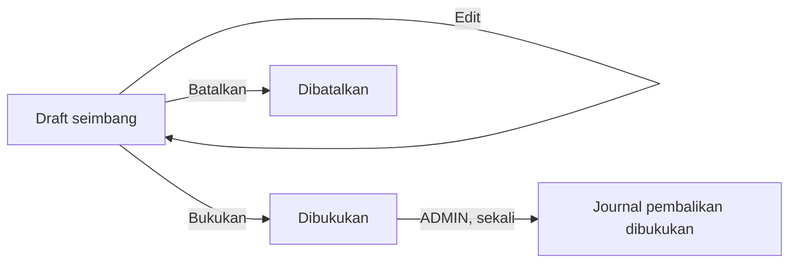

# Accounting — Journals and ledger

Live API mode provides `/accounting`, `/chart-of-accounts`, `/journal-entries`, `/general-ledger`, and `/trial-balance`. These pages use PostgreSQL data for the active Company. Browser-local demo mode explicitly identifies this functionality as API-only.

Manual double-entry Journals remain available. Company ADMINs can now activate financial posting from Sales/Purchase Invoices, Payments and Stock through an explicit mapping/opening workflow at `/automatic-accounting`. See [Automatic Accounting](automatic-accounting.md) for adoption, posting rules, generated Journal protection and limits. Companies without activation retain manual-only Accounting. Operational Invoice Reports keep their own definitions; this milestone does not provide complete financial statements.

## Chart of Accounts

- Accounts belong to one Company. Types are Asset, Liability, Equity, Income and Expense. Root Accounts must be groups; transaction Accounts require an active group parent with the same type in the same Company. Nested groups are supported.
- Code, type, group flag and parent are immutable after creation. Names and status may change with `expectedUpdatedAt`. Codes are unique within the Company and normalize to uppercase.
- An active child prevents its parent from being deactivated. Reactivation requires an active parent. Journal preparation/posting accepts only active transaction Accounts, while historical reads include inactive Accounts.
- There is no delete endpoint. Deactivation preserves history. A compound foreign key enforces Company/type identity independently of API validation. Journal lines retain Account code/name/type snapshots.

## Journal lifecycle

Each Journal contains 2–50 distinct Accounts. A line has a positive debit **or** credit; values have at most two decimals. Total debit must equal total credit, be greater than zero, and not exceed 1,000,000,000,000 in the Company currency. The form displays debit, credit and difference as the user edits. Shared validation sums integer cents; database writes and ledger aggregation use Decimal/numeric.

Balanced drafts may be edited in full or cancelled. Neither affects the ledger. Posting revalidates active same-Company Accounts and the current document version. Posted/cancelled documents cannot be edited or transitioned again through the API. Journal creation locks Company currency, including when the Journal is still a draft.

An ADMIN may reverse an original posted Journal once, on/after its date. The API creates and immediately posts a new Journal with opposite debit/credit and a required reason. The original remains posted and visible, with a link to its reversal. Reversal preserves original Account snapshots and can use Accounts that have since been deactivated. Reversing a reversal is not supported in this scope. A Company/source unique constraint plus Serializable isolation prevents concurrent duplicate reversals.

Creation/reversal uses a UUID `requestKey`, payload hash and creator identity. Retrying the same request returns the same Journal; reusing its key with changed content fails. Document numbers are allocated atomically per Company/prefix/year (`JV` and `JVR`). All writes recheck active User, Company membership/Role, active Company and versions inside the transaction; audit records commit atomically.

The eighth migration adds a deferred balance constraint checking header/line sums and line count at commit. This permits an atomic draft line replacement while rejecting incomplete or unbalanced documents even through direct SQL. PostgreSQL supports deferred constraint triggers ([official documentation](https://www.postgresql.org/docs/current/sql-createtrigger.html)). Posted immutability and lifecycle rules are enforced by the application API; database administrators with direct write access are outside that API boundary. These are not tamper-proof or legally certified ledgers.

## Reports

Select an inclusive period of at most 366 days. General Ledger requires a transaction Account. Opening balance is all posted debit minus credit before the start date; period movements include both dates. Running balances include all previous matching rows before pagination, ordered by document date, creation time, Journal ID and line ID.

Trial Balance includes all transaction Accounts, including inactive/zero-balance Accounts. Opening is signed debit minus credit. Closing is split into Debit/Credit columns. Its totals cover the entire Company chart, including Accounts outside the current page. Draft/cancelled Journals are excluded; posted reversals appear as separate entries. There is no persisted opening-balance field: record an explicit balanced Journal when appropriate.

Each response uses a Repeatable Read transaction. Aggregated monetary amounts are **decimal strings**, formatted without conversion to floating point; very large totals retain their fractional values. Individual Journals use bounded numeric amounts. Each export requests all results in a single snapshot, capped at 10,000 rows; larger results fail explicitly rather than truncating. Export and an earlier screen view are separate snapshots. Company switching hides previous results, closes the prior context's forms, and cancels pending exports.

Reports follow document dates and current posted data. Backdated posting can change an earlier period; automatic operational posting rejects dates before its Company activation boundary. Period close, fiscal-year setup, multi-currency conversion, tax, bank reconciliation, cash flow, profit/loss and balance-sheet statements remain pending. There is no claim of advanced Accounting completion.

## REST API and Roles

All paths below are under `/api/companies/:companyId/accounting`. Every endpoint requires authenticated membership in the path Company; request bodies cannot override it. Archived Companies remain readable, with writes blocked.

| Method | Path | Access / purpose |
| --- | --- | --- |
| GET | `/summary` | Account, posted Journal and draft counts |
| GET | `/accounts` | Search `q`, `type`, `node`, `status`, code `direction`, pagination |
| POST | `/accounts` | ADMIN/MANAGER, create chart Account |
| PATCH | `/accounts/:id` | ADMIN/MANAGER, versioned name/status update |
| GET | `/journals`, `/journals/:id` | Scoped list/detail; list search/status/date direction |
| POST | `/journals` | ADMIN/MANAGER, idempotent balanced draft |
| PATCH | `/journals/:id` | ADMIN/MANAGER, full draft update with version |
| POST | `/journals/:id/actions` | ADMIN/MANAGER, `post` or `cancel`, version required |
| POST | `/journals/:id/reversal` | ADMIN only; UUID, date, reason and source version |
| GET | `/ledger`, `/trial-balance` | All members including VIEWER; `from`, `to`, pagination; ledger also `accountId` |
| GET | `/ledger/export`, `/trial-balance/export` | All matching report rows, same access checks |

Lists return `{ data, meta: { total, page, pageSize, pageCount } }`; normal page size is 1–100. Search uses literal substring matching. Journal detail omits internal idempotency hashes/keys. Global search finds Account codes/names and Journal numbers/references/descriptions in the active Company.

## Development and checks

After the normal database setup, run `npm run db:seed:accounting`. It adds an illustrative chart to Alpha/Beta and three manual posted Journals: Alpha capital 1,500,000.25 and expense 150,000.10; Beta capital 900,000.50. They are fictional development fixtures independent of existing Invoices/Payments. Existing chart profiles and Journals are preserved on repeat runs; existing drafts are never advanced by reseeding. Gamma remains a read-only empty example.

Run `npm run verify`, `npm run test:accounting` and `npm run test:ui:live` against the development API/database. The API checks use a disposable Company and verify RBAC/scoped foreign keys, chart invariants/version conflicts, draft editing/idempotency, currency locking, concurrent posting/reversal, deferred database balance rollback, inactive historical Accounts, precise period aggregation and running balances across pages, full export, audit integrity and archived-Company protection. The UI test exercises real React forms/pickers, posting and reversal confirmations, two ledger pages, complete CSV export, Trial Balance, and Company isolation through the Next.js proxy. These jsdom checks verify functionality, not desktop/mobile layout.
