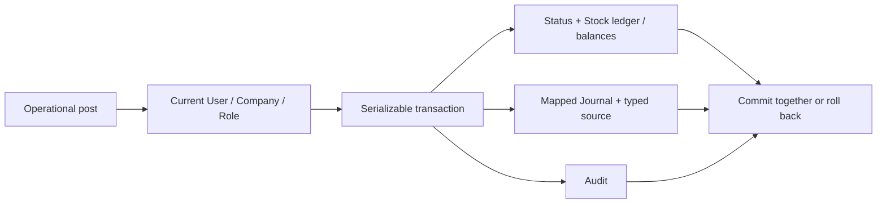

# Automatic operational Accounting

`/automatic-accounting` adds an explicit, ADMIN-only activation workflow per Company and a read-only operational posting register. One Company may use automatic Accounting while another continues without it. The primary navigation hierarchy is unchanged; **Posting Otomatis** sits inside Accounting. General Ledger and Trial Balance include both manual and generated posted Journals.

This implements financial posting for the application's current stock-tracked, full-document Procurement/Sales workflows and Inventory transactions. It does not add tax, foreign exchange, partial settlement, service purchasing, returns, posted-document reversal, fiscal close or financial statements. Operational Dashboard/Invoice Reports retain their existing definitions.

## Activation and existing data

1. Prepare ten distinct active transaction Accounts in the Company's chart, using the required types below. Only Company ADMIN can activate. MANAGER and VIEWER can inspect the policy/register but cannot change it.
2. Review the displayed current Inventory value, unsettled Sales/Purchase Invoices and unbilled Purchase Receipts. Select a start date on/after today, strictly after the date of every previously posted financial/Stock event. This intentionally establishes a clean document-date boundary.
3. Select each Account and provide a reason. The confirmation explains the one-time opening entry and locked mapping. A snapshot key rejects activation if relevant operational totals/history changed since review.
4. Activation runs under Serializable isolation, locks the Company row, rechecks access and validates every Account. It records the policy, mappings, opening snapshot, optional opening Journal and audit atomically. An identical request key/payload by the same ADMIN is idempotent; subsequent configuration changes are rejected.

Opening debits Inventory and Accounts Receivable, credits Accounts Payable and GRNI, and balances the difference against Opening Equity. Inventory uses current StockBalance book value; receivables/payables use posted Invoices less posted full Payments; GRNI is the value of posted Receipts with no posted Purchase Invoice. A draft successor does not clear GRNI. If all opening values are zero, the policy is still activated without an empty Journal. Generated Journals retain the existing limit of 1,000,000,000,000 per Journal.

The opening entry is an adoption snapshot, not a reconstruction of historical revenue, costs or cash. Old documents, Stock ledger rows and manual Journals are preserved. Legacy posted Receipts/Invoices before the boundary can continue into new Invoices/Payments: their unbilled/outstanding balances are already covered by the opening entry. Cash/bank opening balances are not inferred and may be recorded explicitly through manual Journals. Review the complete chart for overlapping historical accounts; the software cannot infer their business meaning.

The four control Accounts — Inventory, GRNI, Receivable and Payable — must never have appeared in a Journal line before activation, including drafts/cancelled records. This prevents automatic carry-forward from duplicating an existing balance in those Accounts. After activation, manual Journal preparation/posting cannot use them. Use new dedicated control Accounts when earlier manual accounting exists. Cash, income, expense and equity Accounts can still be used manually.

Once activated, the date/mappings cannot be edited or disabled through the API. Mapped Accounts cannot be deactivated, and Company currency is locked even when the opening is zero. Account names remain editable; each Journal stores its Account snapshots. A future configuration version/changeover workflow remains pending.

## Posting rules

| Event | Debit | Credit | Basis |
| --- | --- | --- | --- |
| Purchase Receipt | Inventory | GRNI | Receipt value |
| Purchase Invoice | GRNI | Accounts Payable | Full linked Receipt value |
| Outgoing Purchase Payment | Accounts Payable | Cash / Bank | Full Invoice settlement |
| Delivery Note | Cost of Goods Sold | Inventory | Actual moving-average Stock cost |
| Sales Invoice | Accounts Receivable | Sales Revenue | Selling value, independent of Stock cost |
| Incoming Sales Payment | Cash / Bank | Accounts Receivable | Full Invoice settlement |
| Positive Stock Adjustment | Inventory | Stock Gain | Posted addition value |
| Negative Stock Adjustment | Stock Loss | Inventory | Actual withdrawn book value |
| Same-Company Warehouse Transfer | No financial Journal | No financial Journal | One Company-wide Inventory Account; total value conserved |
| Full Work Order completion | No financial Journal | No financial Journal | Material value becomes finished-goods value in the same Inventory Account |

Mixed Adjustments retain separate gain and loss lines; only the Inventory side is netted. A valid movement with zero rounded value has a source posting record but no zero-value Journal. Transfer/production likewise retain explicit source records and their normal Stock ledger movements. The current single Inventory Account does not distinguish raw materials, WIP, finished goods or individual Warehouses financially.

The basic Receipt/Invoice/Payment and Delivery/Invoice separation follows the [official ERPNext accounting-entry explanation](https://docs.frappe.io/erpnext/accounting-entries); GRNI clearing follows its [stock received but not billed documentation](https://docs.frappe.io/erpnext/stock-received-but-not-billed). The implementation is original and restricted to this project's existing workflows, without copying ERPNext code or representing its complete accounting feature set.

## Atomicity and source identity

Each operational service calls a shared posting function inside the same Serializable transaction as its status, Stock cost/balance/ledger and business audit changes. Mapping failure, unbalanced/oversized entries, a pre-activation posting date or serialization failure rolls back the entire operation. Drafts, Purchase Requests, Purchase Orders, Quotations, Sales Orders and cancellations of drafts have no financial effect. An existing source posted after the boundary must already have its Accounting source record before the next Invoice/Payment can post.

`OperationalPosting` has exactly one typed Purchase, Sales, StockOperation or WorkOrder reference, with Company-scoped compound foreign keys and one source record per document. A generated Journal belongs to at most one source. Journals use `MANUAL`, `OPENING` or `OPERATIONAL` origin and separate `JV`, `JVO` and `JVA` numbering. Generated Journals are posted immediately and cannot be manually reversed. Operational returns/reversals are not implemented; arbitrary reversal would separate the financial ledger from Stock and settlement.

Amounts are computed with Prisma Decimal from posted source values. Journal debit equals credit and the header amount. The database retains deferred Journal balance checks and adds typed mapping checks, source exclusivity, zero/nonzero Journal rules, complete mapping requirements, generated status rules, scoped FKs and deferred matching of Journal/source amount/date/reference. These checks support the API; they are not a tamper-proof ledger against privileged database administrators. Source status transitions and exact business calculations remain service responsibilities.

The policy/register is readable by current Company members, including VIEWER and archived Company history. Activation requires active Company ADMIN, and all operational write services retain their current transactional access checks. A request body cannot override Company scope. Internal idempotency keys/hashes and credentials are not exposed by policy or Journal responses.

## REST API

All paths are under `/api/companies/:companyId/accounting`:

| Method | Path | Behavior |
| --- | --- | --- |
| GET | `/policy` | Active mapping/opening metadata, or current opening preview if disabled |
| POST | `/policy/activate` | ADMIN-only reviewed one-time activation |
| GET | `/postings` | Source register with `q`, `page`, `pageSize` (1–100), `direction` |

Activation accepts UUID `requestKey`, the returned `snapshotKey`, ISO `effectiveFrom`, `reason`, and a complete `mappings` object keyed by `INVENTORY`, `GRNI`, `PAYABLE`, `RECEIVABLE`, `CASH`, `REVENUE`, `COGS`, `STOCK_GAIN`, `STOCK_LOSS` and `OPENING_EQUITY`. Required types are Asset for Inventory/Receivable/Cash, Liability for GRNI/Payable, Income for Revenue/Gain, Expense for COGS/Loss and Equity for Opening Equity. All mappings must use different transaction Accounts.

The register returns decimal-string debit totals and scoped source/Journal IDs. Its buttons open the actual business document and Journal detail; zero-effect records explain why no Journal exists. Company switching clears both the previous register and open dialogs. Policy/form/register copy is centralized in the Indonesian-English dictionary.

## Development and verification

`npm run db:seed:automatic-accounting` prepares five dedicated chart groups and ten Accounts in Alpha. It preserves existing Accounts and does not activate a policy or change transactions. Use the UI to review/map/activate; Beta's MANAGER and Gamma's VIEWER are not elevated. The full development seed also prepares this chart after existing fixtures. Existing rows are not overwritten on a repeat run.

`npm run test:automatic-accounting` creates disposable Companies, chart and real Procurement/Sales/Inventory/Manufacturing workflows. It checks opening, legacy continuity, double-entry mappings, actual costs, settlement, duplicate/concurrent posting, zero-value/neutral sources, invalid configuration rollback, database constraints and control-account reconciliation. The live React DOM suite includes form validation, pickers, confirmation/cancel, zero opening, real source/Journal drill-down and Company isolation. Run database-mutating suites sequentially with unchanged production rate limits. Browser layout verification is separate from jsdom; see [verification results](verification.md).

Financial statements, fiscal periods/close, multi-currency, tax, bank reconciliation, split cash/bank selection, item/Warehouse-specific financial Accounts, overhead/WIP, partial documents, returns/reversals and editable mapping versions remain pending.
