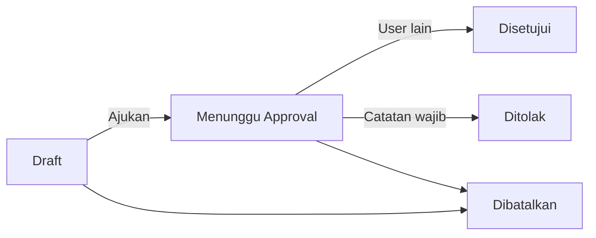

# Human Resources — Employees, Attendance and Leave Requests

Live API mode provides an HR workspace at `/human-resources`, the directory at `/employees`, the request register at `/leave-requests`, and operational Attendance at `/attendance`. See [Attendance](attendance.md) for real recording/corrections, Company access, Leave consistency, REST routes and limits. Browser demo mode retains separate prototype data. Payroll, employee self-service, entitlements, holiday/shift calendars, attachments, and approved-leave cancellation are not implemented.

## Employees

Employee records contain a company-specific code, name, work email/phone, job title, employment type, Branch, Department, joining date, status, and optional employment end date. They do not contain salary, identity numbers, bank accounts, medical records, or a login account. An Employee is distinct from an application User.

- A company member can read the directory. ADMIN/MANAGER Roles can create/update; VIEWER remains read-only. Every write rechecks active User, company membership/Role, and active Company inside the database transaction.
- Codes normalize to uppercase, are unique within the Company, and cannot change after creation. Read/search/filter/sort/pagination operate on the server. Changing Company suppresses prior results and closes the prior context's forms.
- Branch and Department must be active, in the same Company, and linked to each other. The Department selector follows the chosen Branch and resets when it changes. A legacy Department with no Branch must first be assigned a Branch through Organization.
- Compound database foreign keys independently enforce Company and Branch/Department identity. A used Department cannot change Branch; its database FK uses `ON UPDATE RESTRICT`. Moving an Employee means explicitly choosing a matching destination Branch and Department.
- An active Employee prevents Branch/Department deactivation. Any referenced organizational record is protected from deletion, including links held by inactive Employees. Inactive Employees can retain unchanged inactive organizational references for historical reads; reactivation requires active references.
- Active Employees have no employment end date. Inactive Employees require an end date on/after joining. Status is manual and takes effect when saved: dates do not schedule future activation/deactivation. Counts reflect stored status, not historical headcount at a selected date.
- Employee records are retained rather than deleted. Deactivation through the form requires confirmation. Employee date edits cannot invalidate draft/pending/approved Leave periods, and pending requests must be resolved/cancelled before deactivation or an organizational move.
- Updates require `expectedUpdatedAt`; Serializable transactions and monotonic update versions prevent stale/concurrent changes from overwriting one another. Audit entries commit with the change.

## Leave workflow



HR staff with ADMIN/MANAGER access prepare requests on behalf of active Employees. There is no mapping from Employee to login User and no employee self-service portal.

1. Select an active Employee from the current Company, a leave type, inclusive start/end dates and a reason of at least five characters. Dates must fit within the Employee's employment period. Maximum request span is 366 calendar days.
2. The server calculates **Monday–Friday working days**. Weekend-only requests are rejected. This is a basic counting policy without public holidays, shifts, fractional days, remaining balances, or statutory entitlement calculations. Types are Annual, Sick and Other; they do not automatically accrue or consume an entitlement balance.
3. Drafts do not reserve dates. On submission, the API revalidates the Employee and reserves the entire inclusive interval against other **PENDING/APPROVED** requests for the same Employee. Concurrent overlapping submissions cannot both succeed under Serializable isolation. Rejected/cancelled requests release the interval.
4. Approval/rejection requires a different User from the request's creator, with ADMIN/MANAGER access to the same Company. This restriction applies to ADMIN too and is also enforced by a database CHECK. Rejection requires a review note of at least five characters.
5. The creator or an ADMIN may submit/cancel a draft and cancel a pending request. Another MANAGER can review a pending request but cannot submit/cancel someone else's draft. Approved, rejected and cancelled requests are terminal and immutable through the API. For changed draft content, cancel it and create a replacement. Cancelling approved leave requires a future reversal workflow.

The request stores Employee/organization labels at creation and refreshes them on submission; later Employee renaming/moves do not rewrite submitted history. Detail dialogs show creator, submission date, reviewer/date, note and status. The API stores atomic audit events for every create/transition. The Company-level HR workspace shows active/inactive headcounts, active Employee counts by Branch, and pending requests. Global search includes Employees and request numbers; notifications remain the existing Procurement notification preview/service scope.

## REST API

All paths below are under `/api/companies/:companyId/hr`, require authentication, and use the company membership guard. Reads remain available for archived Companies; writes are blocked. Request bodies cannot override the path Company.

| Method | Path                          | Purpose                                                         |
| ------ | ----------------------------- | --------------------------------------------------------------- |
| GET    | `/summary`                    | Stored-status headcounts, counts by Branch, pending requests    |
| GET    | `/employees`                  | Search/status/Branch/Department filters, sorting and pagination |
| GET    | `/employees/:id`              | Scoped Employee profile                                         |
| POST   | `/employees`                  | Create, ADMIN/MANAGER                                           |
| PATCH  | `/employees/:id`              | Full validated update with `expectedUpdatedAt`                  |
| GET    | `/leave-requests`             | Search/status/Employee filters, date sorting and pagination     |
| GET    | `/leave-requests/:id`         | Request detail with maker/reviewer labels                       |
| POST   | `/leave-requests`             | Create idempotent draft, ADMIN/MANAGER                          |
| POST   | `/leave-requests/:id/actions` | Versioned `submit`, `approve`, `reject`, `cancel`               |

Lists return `{ data, meta: { total, page, pageSize, pageCount } }`, with page size 1–100 (default 10) and oversized pages clamped to the final page. All filters preserve Company scope. Employee sorting permits `code`, `name`, `startDate`, `status`, `createdAt`; direction is `asc`/`desc`. Leave lists sort by start date with deterministic creation/ID tie-breakers. Read responses use Repeatable Read transactions.

Employee example:

```json
{
  "code": "EMP-003",
  "name": "Dewi Anindita",
  "email": "dewi@example.local",
  "phone": "",
  "jobTitle": "Operations Specialist",
  "branchId": "same-company-branch-id",
  "departmentId": "department-of-that-branch-id",
  "employmentType": "PERMANENT",
  "status": "ACTIVE",
  "startDate": "2026-01-05",
  "endDate": ""
}
```

Leave creation accepts `requestKey` (UUID), `employeeId`, `type` (`ANNUAL`, `SICK`, `OTHER`), `fromDate`, `toDate` and `reason`. The server supplies number, days, status and company. UUID keys plus normalized request hashes make identical same-actor retries return the existing request, while a changed payload/actor conflicts. Number allocation uses `LV-{companyCode}-{year}-{sequence}` atomically per Company/year. Private request hashes/keys are omitted from responses.

Actions accept:

```json
{
  "action": "approve",
  "expectedUpdatedAt": "2026-10-21T12:00:00.000Z",
  "note": "Disetujui setelah pemeriksaan jadwal"
}
```

The catalog list query also accepts `branchId` for Department/Warehouse selectors, applying the filter before pagination.

## Database and development fixtures

Apply all checked-in migrations with `npm run db:generate` and `npm exec -w @erp/api -- prisma migrate deploy`. The HR migration adds Employee/LeaveRequest tables, enums, indexes and scoped relationships without backfilling/replacing existing records. A following constraint correction explicitly rejects NULL end dates for inactive Employees, since PostgreSQL CHECK otherwise permits unknown/NULL results. Existing-table fingerprints were verified unchanged after both migrations.

`npm run db:seed:hr` creates two fictional Employees each for Alpha/Beta, an Alpha request pending review, and a Beta draft through the actual business services. Gamma remains a read-only empty HR example. Existing Employees/requests are preserved and never advanced by reseeding. Ineligible employment/organizational references and occupied periods are skipped.

The development-only account **`reviewer@enterprise.local`** (Rani Prameswari) receives MANAGER access to Alpha and uses `DEMO_PASSWORD` on first creation. Existing reviewer password/profile/membership values are preserved on rerun. Use `admin@enterprise.local` to prepare the seeded Alpha request and sign in separately as the reviewer to approve it; the admin creator cannot approve its own request. These credentials are for isolated development only. The normal `db:seed` command includes HR after its existing fixtures.

## Checks and limits

```sh
npm run verify
npm run test:hr
node scripts/verify-phase2.mjs
npm run test:ui:live
node scripts/verify-routes.mjs
```

HR API checks cover same-company/same-Branch foreign keys, version races/audit counts, Employee lifecycle and dependent-record protection, idempotency, numbering, date calculations, maker/reviewer separation, overlap races, duplicate review protection, immutable terminal states, Role enforcement, pagination and archived-Company reads. The React DOM integration test creates/edits Employee data, switches Branch and Department, submits a request, logs in as another User to approve it, confirms deactivation, and changes Company without stale rows.

These are functional checks using real API/PostgreSQL and jsdom. Authenticated desktop visual QA remains pending; mobile will be developed separately by the owner. HR authorization currently uses the application's coarse Company ADMIN/MANAGER/VIEWER policy. Basic Attendance recording, audited corrections and Leave consistency are implemented; see [Attendance](attendance.md). Module-specific permission administration, employee self-service, separate reporting managers, configurable Approval chains, entitlements, leave reversal, shifts and payroll require further work.
