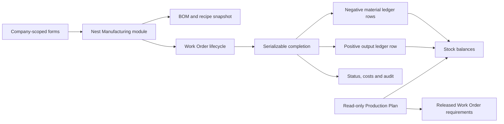
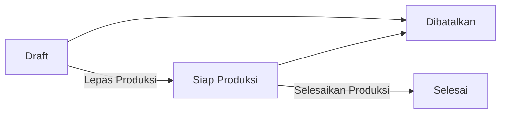

# Manufacturing — BOM, Work Orders and material planning

Live API mode provides `/manufacturing`, `/bill-of-materials`, `/work-orders`, and `/production-plan`. Company switching resets the prior context's forms/results. Browser-local demo mode identifies these features as API-only. The primary navigation names remain unchanged.

## Scope and design

This milestone implements **single-level, full-quantity assembly in one Warehouse**. A BOM specifies positive whole-number output and material quantities per batch. A Work Order snapshots that recipe and multiplies it by a whole batch count. Completing production consumes the materials and receives the finished Item in one Serializable database transaction.

It does not implement nested BOM explosion, WIP, overhead/labor allocation, machine capacity, routing, partial production, scrap/by-products, reservations, lots/serials, production reversal or automatic purchasing. After Company [automatic Accounting](automatic-accounting.md) activation, completed production retains an Accounting source record without a Journal because material/output value stays in the same Company-wide Inventory Account. Separate raw/WIP/finished financial Accounts and overhead entries remain pending.

The existing modular monolith and PostgreSQL database remain the deployment boundary. Manufacturing owns BOM/Work Order lifecycle and material planning; Inventory owns movement/balance semantics. Manufacturing calls the same transaction-only `postStockMovement` helper used by Procurement, Sales and Inventory. It never updates Stock balances independently.

The UI follows the existing calm, dense workspace: module tabs, a working document register, one primary create action, and a detail dialog for context. BOM composition and scaled Work Order requirements use readable rows. Production Plan has one purpose: compare released material demand with current Stock. Existing dialog entrance/focus behavior, navigation transitions and row hover affordances provide restrained motion; no decorative dashboard mosaic or hero is added.

## BOM lifecycle

1. Prepare a draft BOM with a unique uppercase code, name, stock-tracked output Item, output quantity, and 1–50 distinct stock-tracked material Items. Output cannot also be an input to the same BOM. All Items must be active in the same Company.
2. A draft may be edited in full with `expectedUpdatedAt`; its code remains immutable. Activation revalidates Items and makes its composition immutable through the API.
3. Active BOMs may be retired (`INACTIVE`) but cannot be reactivated or edited in this scope. Create a new BOM code for a revision. Retired BOMs cannot create Work Orders or release existing drafts. Already released Work Orders can finish using their retained snapshot.

There is no BOM deletion endpoint. Compound foreign keys enforce Company identity. Deferred database checks require 1–50 distinct materials and exclude output self-consumption, including during an atomic draft replacement.

## Work Order lifecycle and access

Creation requires an active BOM and Warehouse in the selected Company, batch count and planned date. Each scaled material/output quantity must remain within 1–1,000,000. Work Orders retain BOM code/name and Item labels/units/quantities as snapshots. They cannot be edited; cancel a draft/released order and create a replacement. Creating a Work Order locks Company currency even when all Item prices are zero.

Release adds requirements to Production Plan and rechecks the active BOM, Items and Warehouse. **Release does not reserve or consume Stock**. A released order may therefore have shortages. Cancellation has no Stock effect. Completed/cancelled records are terminal and immutable through the API.

All endpoints require Company membership. VIEWER can read; ADMIN/MANAGER can prepare/activate/retire BOMs and create/release/complete/cancel Work Orders. Every write rechecks the active User, Company, membership and Role within its transaction. Work Order completion is allowed for MANAGER; posting a separate Stock Adjustment retains its existing ADMIN-only policy. Archived Companies remain readable but reject mutations.

Work Order creation uses UUID idempotency keys, payload hashes and creator identity. Repeating identical content returns the same document; changed content or another creator cannot reuse its key. Numbers are allocated atomically per Company/year with `WO`. Monotonic update versions reject stale transitions. Audit events commit atomically with document changes.

## Stock and valuation

Completion requires an actual posting date and current document version. The actual date is independent of the planned date; it cannot precede the latest Stock movement of any affected material/output in that Warehouse. There is no period-closing or future-date restriction in this development scope.

The server rechecks active stock-tracked Items and Warehouse, current balances and date ordering. Costs use the existing moving-average algorithm: material depletion rounds to two decimals, while full depletion consumes the exact remaining value. Unit cost snapshots use six decimals. The finished Item receives **the sum of actual material costs**, preserving total Inventory value; no overhead is invented. Zero-value material Stock is allowed. Maximum production value is 1,000,000,000,000 in the Company currency, with existing Inventory balance limits also enforced.

Material cost updates, all negative material ledger rows, one positive output ledger row, balances, completed status/date/actor and audit either commit together or roll back together. Competing completions cannot overdraw Stock; a second attempt to complete the same document conflicts. A unique Company/Work Order/Item ledger key prevents duplicate source posting.

The ninth migration adds a fourth exclusive typed Stock source (`workOrderId`). Deferred database checks require completed production's ledger to match every input quantity/cost, output quantity/value, Warehouse and posting date, with total input/output value conserved. Uncompleted orders cannot have costs or Stock ledger rows. These checks also reject inconsistent direct SQL updates. Lifecycle immutability is enforced through the API; database administrators remain outside that application boundary.

Used input/output Items cannot change unit or Stock-tracking mode, or be deleted. Work Order Warehouses are protected from deletion. Deactivating an Item/Warehouse preserves history and blocks subsequent release/completion until the reference is eligible again.

Stock Movement identifies the source as Work Order and opens its detail. Completed detail shows posted costs; availability/shortage columns are reserved for open orders, so consumed materials do not appear as an unresolved shortage after production.

## Production Plan

This page is a **read-only material requirement projection**, not a persisted production schedule. It sums only RELEASED Work Orders whose planned dates fall within the inclusive selected period (maximum 366 days), grouped by material and Warehouse. Draft/completed/cancelled documents are excluded. An optional Warehouse filter is validated against Company membership/context.

Each row shows total required quantity, current available Stock and `max(required − available, 0)`. Requirements from multiple orders compete for the same balance; they are not individually allocated. Availability is current, not historical as of the selected end date. Pending receipts, transfers, reservations and production output supply are not projected. No Purchase Order is generated from a shortage.

Each response reads one Repeatable Read snapshot. Aggregated quantities are decimal integer strings to avoid JavaScript precision loss. Rows are paginated on the server with deterministic ordering; the order count covers all matching Work Orders. BOM/Work Order lists also support Company-scoped search, status filters, sorting and pagination.

## REST API

All paths are under `/api/companies/:companyId/manufacturing`. Request bodies cannot override the path Company.

| Method | Path | Purpose |
| --- | --- | --- |
| GET | `/summary` | Active BOM, released and completed order counts |
| GET | `/boms`, `/boms/:id` | Scoped recipe list/detail |
| POST | `/boms` | Create draft BOM |
| PATCH | `/boms/:id` | Replace draft fields/lines with version |
| POST | `/boms/:id/actions` | Versioned `activate` or `retire` |
| GET | `/work-orders`, `/work-orders/:id` | Scoped list/detail; detail includes live material availability |
| POST | `/work-orders` | Create idempotent draft from active BOM |
| POST | `/work-orders/:id/actions` | Versioned `release`, `complete`, `cancel`; completion requires `postingDate` |
| GET | `/plan` | Released requirements by `from`, `to`, optional `warehouseId`, pagination |

Lists return `{ data, meta: { total, page, pageSize, pageCount } }`. Default page size is 10; valid sizes are 1–100 and oversized page numbers clamp to the final page. Search is `q`; code/date order is controlled by `direction`. Internal request keys/hashes and actor IDs are omitted from document responses. Global search includes scoped BOM and Work Order records.

## Development fixtures and verification

Run `npm run db:seed:manufacturing` after migration/build, or use the full seed. It adds three fictional stock-tracked Items and an active BOM to Alpha/Beta. Alpha receives development materials through an ADMIN Stock Adjustment, completes a two-batch Work Order through the normal service, and retains an open ten-batch order. Beta has an open three-batch order with an intentional material shortage; its MANAGER Role is not elevated to bypass Inventory permissions. Gamma remains an empty read-only example.

Repeat seeds preserve existing Item profiles, recipes, requests, statuses and posted Stock. Existing drafts are never advanced. If a seed fixture is changed into an ineligible state, the seed skips dependent creation instead of restoring the user's old values.

Run `npm run verify`, `npm run test:manufacturing` and `npm run test:ui:live` against the development database/API. Integration checks create disposable Companies and remove only their own data. They verify scoped FKs and authorization, lifecycle/version conflicts, idempotency/numbering, batch limits, planning aggregation, shortage rollback, concurrent completions, exact residual allocation, conserved Inventory value, database consistency checks, protected masters and archived history. UI tests exercise the actual BOM/Work Order forms, confirmations, shortage feedback, completion, Stock Movement source dialog and Company switching through the Next.js proxy. jsdom verifies functionality, not browser layout.

## Trade-offs and future work

Whole-number batches and single-Warehouse atomic completion keep valuation and failure handling reviewable in this modular monolith. The trade-off is the absence of partial consumption, production floor/WIP state and capacity scheduling. Retaining immutable active recipes and document snapshots avoids implicit changes to released requirements; revisions require a new code. Serializable conflicts are surfaced as retryable 409 responses rather than hidden retries of business actions.

As usage grows, revisit reservations, decimal units/yield, BOM revision/effectivity policy, nested explosion with cycle detection, WIP transfers, worker/machine capacity, cost-center/overhead allocation, production reversal and Accounting mapping. Add indexes/async planning only in response to measured query volume and latency; no queue, cache or new service is required for the current portfolio scope.
