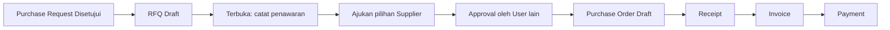

# Operational Request for Quotation

In live API mode, `/requests-for-quotation` uses NestJS/PostgreSQL and real Company-scoped Purchase Requests, Suppliers and Items. Demo mode retains the separate, labeled browser prototype. Prototype records are never imported into operational documents automatically.

## Workflow and Approval boundary

1. Select an approved Purchase Request without an active Purchase Order or RFQ. Its original Supplier remains the reference Supplier; its Items, integer quantities, Warehouse and currency remain unchanged. Choose two to ten active Suppliers in the same Company and save a draft RFQ. Requirements and invitations are immutable after creation; cancel and create another RFQ to change them.
2. Open quotation recording. This is an internal state change, **not an email/message delivery**. Enter the Supplier's quotation reference/date, validity, delivery days and a positive price for every requested Item. Prices have at most two decimal places. The quote date must fall within the RFQ's date/deadline and cannot be after today in Asia/Jakarta. Historic quotations may be recorded after the deadline if their document date was within that period.
3. Compare at least two complete quotations. The list shows totals, delivery days, validity and the difference from the Purchase Request estimate. Missing responses from other invited Suppliers do not block selection once two complete offers exist. The system does not automatically choose the cheapest Supplier.
4. Propose one unexpired quotation with a reason. This freezes all offers. Another ADMIN/MANAGER must approve or reject the **specific Supplier and price**, including any amount above the original estimate. Even ADMIN cannot approve their own proposal. The original Purchase Request Approval is never treated as implicit permission to change its Supplier or prices.
5. Generate a draft Purchase Order from the approved award. The backend copies the awarded Supplier/prices, original quantities/Item snapshots, currency and Warehouse atomically. The Order keeps both its original Purchase Request source and an RFQ link. Review and post it using the existing Procurement workflow, then continue Receipt → Invoice → Payment. RFQ operations do not change Stock or Accounting balances.

| Current state | Permitted operations |
| --- | --- |
| Draft | Open quotation recording; cancel with reason |
| Open | Record/update full offers; propose with reason; cancel |
| Pending | Approve/reject as another User; cancel |
| Approved | Generate an Order; cancel only with no active Order |
| Rejected / Cancelled | Read history; start a new RFQ for the still-eligible Request |

Cancellation keeps the selected offer, proposer, reviewer and original review note as historical facts. It cannot cancel an active Purchase Order or reverse posted transactions. A cancelled draft Order can be replaced from the same still-valid approved award. There is at most one active Order per Purchase Request; no implicit duplicate Orders are created. An expired approved award without an active Order can be explicitly cancelled before a new RFQ is prepared.

## Storage, access and consistency

RFQ lives inside the Procurement module of the modular monolith. Four tables represent `Rfq`, immutable `RfqSupplier` invitations, the latest `RfqOffer` per invited Supplier and `RfqOfferLine` pricing. The original approved Purchase Request supplies the requirements. Audit events retain previous offer values, selected/reviewed decisions and Order creation history; detail returns the latest 100 events plus the total count.

- Reads require current Company membership. ADMIN/MANAGER writes recheck the active User, current Role/membership and active Company inside the transaction. VIEWER and archived Companies remain read-only. The Company is taken from the authorized route; strict schemas reject body overrides.
- Company/reference compound foreign keys independently bind the Request, invitations, Items, selected offer and Order. The selected offer must belong to that same RFQ. A partial unique index permits only one active RFQ per Request. A Request with active RFQ cannot bypass it through the old direct Order conversion endpoint.
- UUID create keys are normalized and scoped per Company. Creation/Order retries return the original record only for the same actor and normalized payload. Changed actor/payload conflicts. All other mutations require `expectedUpdatedAt`; row locks, Serializable transactions and monotonic revisions prevent stale overwrites. The source Request acts as a shared lock anchor for direct conversion, sourcing and cancellation.
- PostgreSQL checks/triggers protect state transitions, proposer/reviewer separation, retained cancellation history, original Request history, complete same-quantity offers, exact Decimal totals and matching Order terms. Internal deferred foreign keys allow consistent parent/child transactions without accepting an invalid final state. Inventory remains ledger-based through the existing Receipt posting service.
- A transaction, including document numbering and both RFQ/Procurement audit records, rolls back if creation or audit fails. Serialization/deadlock conflicts exposed by Prisma raw row locks are mapped to HTTP 409 alongside ordinary Prisma transaction conflicts; unrelated constraint/audit errors retain their own handling.

## REST contract

All routes are below `/api/companies/:companyId/rfqs` and use the existing JWT cookie session.

| Method | Suffix | Purpose |
| --- | --- | --- |
| GET | `/` | Search/status/Request filters, date sorting, server pagination |
| GET | `/eligible-requests` | Searchable, paginated approved Request selection |
| GET | `/export` | Entire filtered register in one snapshot, maximum 10,000 |
| GET | `/:id` | Requirements, invitations, offer comparison, award, Orders and audit |
| POST | `/` | Create `{requestKey, sourceId, date, deadline, supplierIds, description}` |
| POST | `/:id/offers` | Record/update `{expectedUpdatedAt, supplierId, reference, date, validUntil, deliveryDays, description, lines:[{itemId, unitPrice}]}` |
| POST | `/:id/actions` | `{action, expectedUpdatedAt}` plus `offerId/reason` for propose or `reason` for approve/reject/cancel |
| POST | `/:id/purchase-order` | `{requestKey, expectedUpdatedAt, date, description}`; award terms cannot be overridden |

Register/export queries: `q`, `status`, optional `sourceId`, `page`, `pageSize` (1–100), `direction=asc|desc`. Exports ignore pagination and fail explicitly over their cap; the CSV is downloaded by the web client. Monetary RFQ responses use Decimal strings. Order responses retain the existing Procurement contract. Errors distinguish validation (400), authentication (401), access (403), scoped missing records (404), workflow/version/concurrency conflicts (409) and throttling (429).

## Desktop and development examples

The live web has paged Request/Supplier selection, validation, list/search/filter/sort, offer forms, comparison, explicit action confirmation, independent Approval, source/Order navigation, audit and CSV export. Company switching resets dialogs and URL-selected source context and cancels a pending export. Shared Indonesian UI copy is under `id.rfq`.

`npm run db:seed:rfq` prepares dedicated fictional examples through the business services: Alpha awaits a separate reviewer; Beta has an open comparison. It does not grant access or automatically approve the award. Use `reviewer@enterprise.local` with the configured development password to review Alpha. Existing/partially prepared seed documents are preserved rather than advanced or overwritten on rerun; Gamma remains read-only.

Run `npm run test:rfq` for the dedicated local API/PostgreSQL verification and `npm run test:ui:live` for actual React form/API checks. Fixtures own disposable Companies and clean up only those rows. See [verification evidence](verification.md).

Supplier email delivery/portals, attachments, partial Item awards, quote-currency conversion, taxes/freight/discounts, configurable Approval policies, notifications for RFQ review, Order returns/reversals and mobile clients remain outside this milestone. The fixed independent-review rule is specific to RFQ awards and does not change the existing coarse Purchase Request Approval policy.
